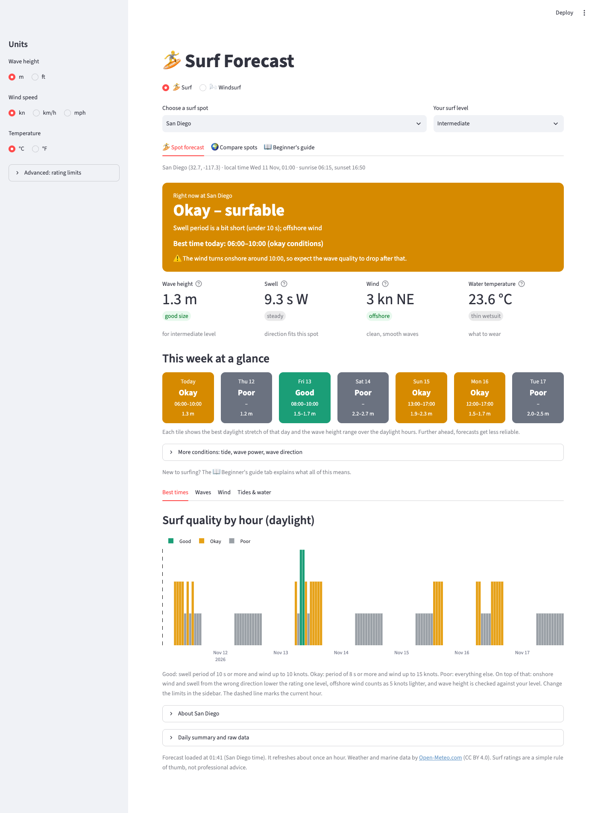
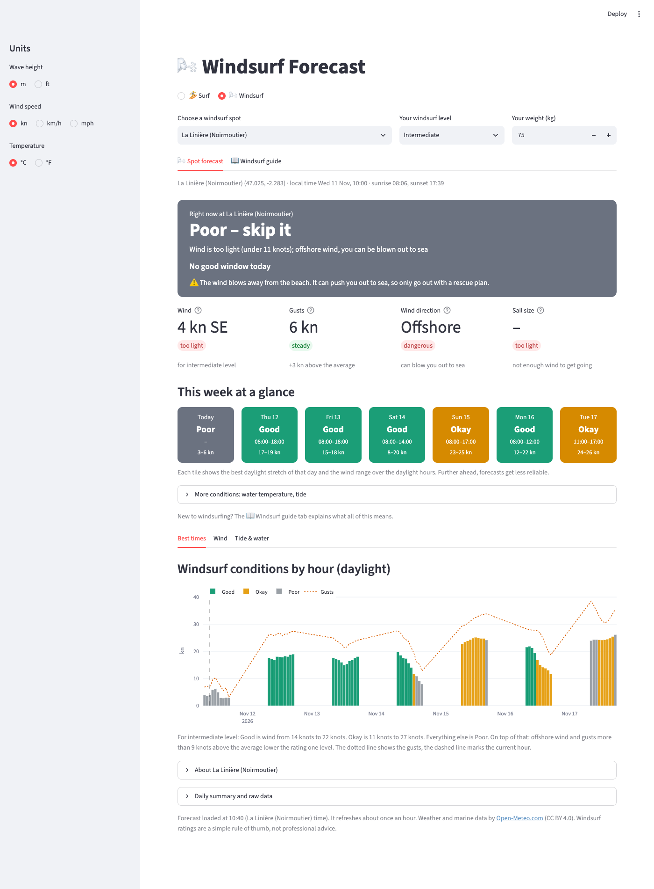
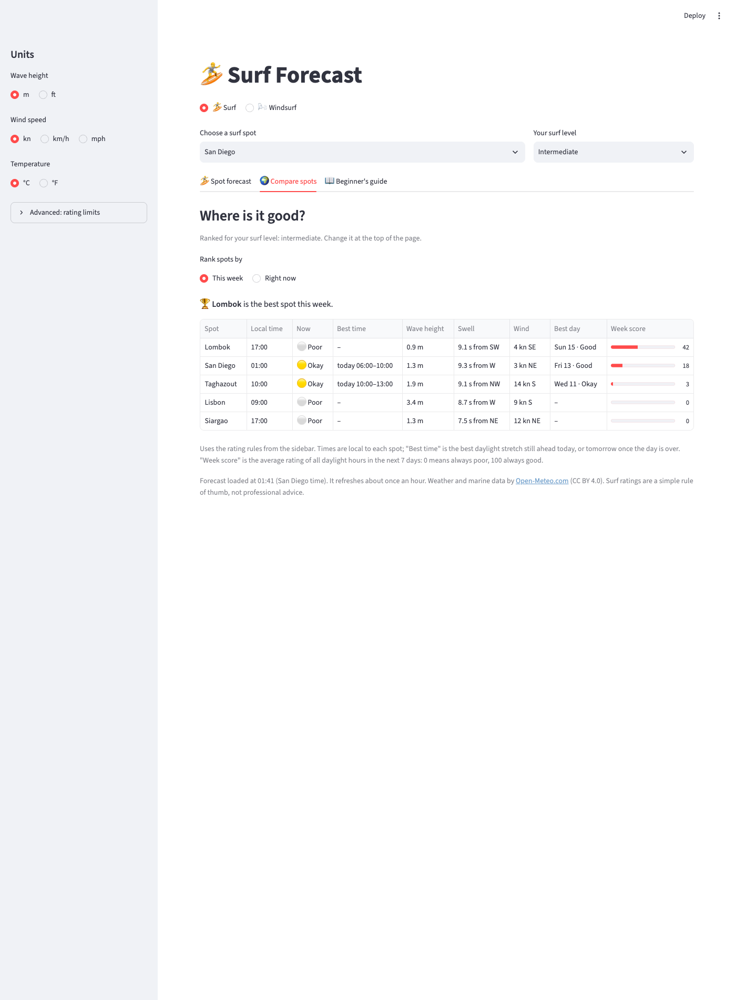
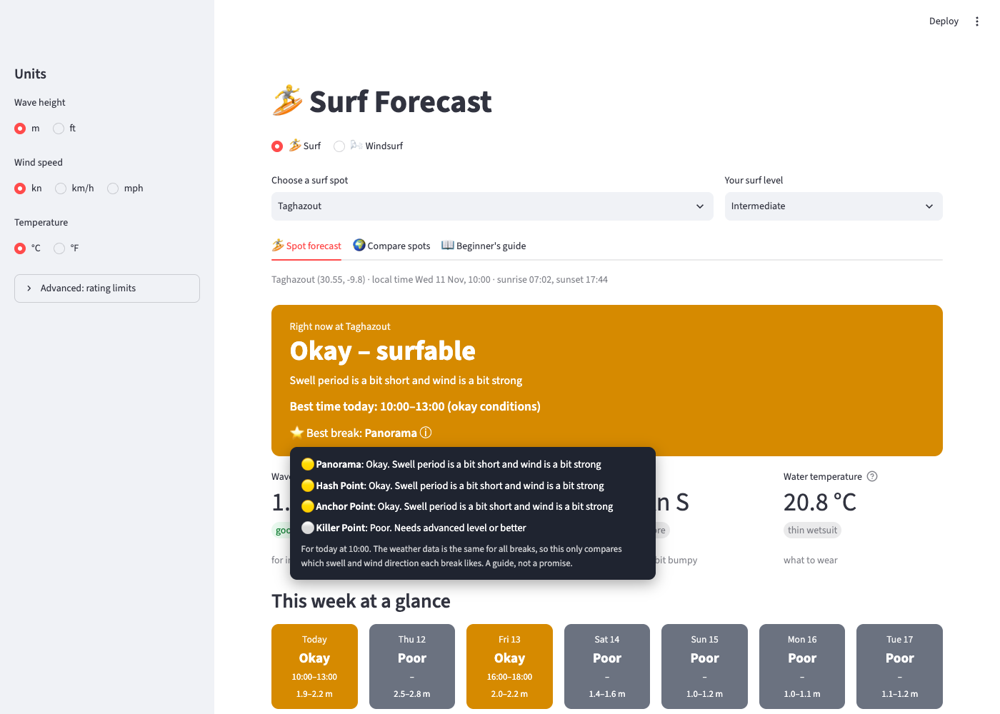
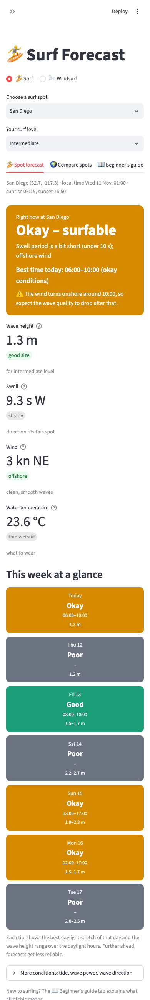

# 🌊 Surf & Windsurf Forecast

[](https://github.com/raphaelthom/surf-app/actions/workflows/tests.yml)

A web app that turns raw weather and ocean data into one simple answer: **should I go out today, and when?**
It rates every hour of the next 7 days for surfing at five spots (Lisbon, San Diego, Siargao, Lombok, Taghazout)
and for windsurfing at La Linière on Noirmoutier, adjusted to your skill level.

**Live app:** https://surf-app-rt.streamlit.app/



## What it does

- **A verdict, not a data dump.** A coloured card says Good / Okay / Poor, why, and the best time window today or tomorrow, with a warning when the wind is about to turn.
- **Rated for you.** The same conditions are rated differently for a beginner and an advanced surfer (wave size range), and for each spot (which way the beach faces, which swell direction works).
- **This week at a glance.** One tile per day with the best daylight window and the wave height range (wind range for windsurfing).
- **Compare spots.** All spots ranked by a week score, or by conditions right now.
- **Windsurf mode.** Rates wind speed for your level, gusts and wind direction. Offshore wind is treated as a safety issue, not just a lower score. It also suggests a sail size from your weight and the wind.
- **Best break at Taghazout.** The spot has several breaks that like different swell and wind. A line in the top card names the best one for the best time of the day, with the full list on hover.
- **A guide for beginners** that explains swell period, wind direction, tide and the rating in plain language.
- Unit toggles (m/ft, kn/km/h/mph, °C/°F), phone-friendly layout, dark mode, and a clean shareable link that only stores the choices you changed.

<table>
  <tr>
    <td></td>
    <td></td>
  </tr>
  <tr>
    <td></td>
    <td></td>
  </tr>
</table>

## How it works

```
Open-Meteo APIs  →  cached, retried requests  →  pandas tables  →  rule-based hourly rating  →  Streamlit + Plotly
(marine + weather)   (1 h cache, timeouts)      (hourly, 7 days)    (spot, level, daylight)      (dashboard)
```

1. **Ingest:** hourly wave, swell, tide, water temperature, wind, gusts, sunrise and sunset from the free
   [Open-Meteo](https://open-meteo.com/) marine and forecast APIs. Requests are cached for an hour and retried
   with timeouts, because the API sometimes stalls.
2. **Prepare:** pandas tables indexed by local time at the spot, unit conversion only at display time, daylight filtering from sunrise and sunset.
3. **Rate:** every hour gets Good / Okay / Poor from simple, explainable rules:
   - *Surf:* swell period and wind give a base rating. Offshore wind counts as 5 kn lighter, onshore wind, a swell direction that doesn't fit the spot, or waves too small for your level lower it by one step, and waves too big for your level make it Poor.
   - *Windsurf:* wind speed against a range for your level, one step lower for uneven gusts, and for offshore wind (Poor for beginners).
4. **Summarise:** best window per day, a 0–100 week score per spot, swell trend over the next 6 hours, wave power (0.49 × height² × period).
5. **Show:** Streamlit page with Plotly charts. The page re-runs on every click, so the logic lives in plain functions.

## Built with AI, as a pair programmer

I built this with [Claude Code](https://claude.com/claude-code) in the terminal, not by pasting code from a chat window.
I'm new to programming (basic Python from a university course) and learned while building. I wrote the first
version (the two API functions and a chart) myself. After that I directed and reviewed the work.

How I worked with it:

- **Plan first, then small steps.** I asked for the plan, agreed or changed it, and then each feature was built, tested and committed as one step (see the commit history).
- **I looked at every change before it went live**, using screenshots and the running app, and sent it back when the UI was off (e.g. the unstructured tabs became three clear views).
- **I made the product decisions.** Some examples:
  - Kept two separate fetch functions so the code stays readable for me.
  - Kept the spot list lean.
  - Made the shared link clean: only choices that differ from the defaults go into the address.
  - Dropped a four-break forecast for Taghazout, because the weather data is identical for all four breaks. It became a "best break" hint instead.
- **My local knowledge beat the model.** For La Linière the wave model showed 2.4 m, but I know the beach is sheltered and barely has waves. So waves were removed from the windsurf rating instead of showing misleading numbers.
- **Guardrails so AI-written code can be trusted:** about 150 unit tests, a GitHub Action that runs them on every push, headless runs of the whole app for every spot, and automated browser screenshots to check the layout on desktop and phone.

## Data limits (please read)

- The forecast is **regional, not exact.** Open-Meteo's grid cells are several kilometres wide, so a spot's numbers describe the area (for example, all Taghazout breaks share one cell, and a sheltered beach can be much calmer than the model's open water).
- The rating rules are **rules of thumb**, not validated against observations. Beach directions and swell windows are rough defaults, partly from public surf guides.
- Tides come from a global sea-level model and show the rough rhythm, not an exact local tide table.
- A natural next step would be to compare the ratings with real observations (buoys or reports) and tune the thresholds from data.

## Project structure

| File | What it does |
|---|---|
| `app.py` | The page: choices at the top, surf dashboard, compare view, beginner's guide |
| `windsurf_view.py` | The windsurf dashboard |
| `surf_logic.py`, `windsurf_logic.py` | The rating rules and calculations (no Streamlit, so they are easy to test) |
| `forecast_data.py` | Loading and caching the API data |
| `charts.py` | The Plotly charts |
| `tests/` | pytest unit tests for both logic files |
| `tools/screenshot.py` | Takes screenshots of every tab for layout checks |
| `.github/workflows/tests.yml` | Runs the tests on every push |

## Run it

```
python3 -m venv .venv
source .venv/bin/activate
pip install -r requirements.txt
streamlit run app.py
```

Run the tests:

```
pip install -r requirements-dev.txt
python -m pytest
```

## License

[MIT](LICENSE)

## Credits

Weather and marine data by [Open-Meteo.com](https://open-meteo.com/) (CC BY 4.0). No API key is needed.
Ratings are a simple rule of thumb, not professional advice.
